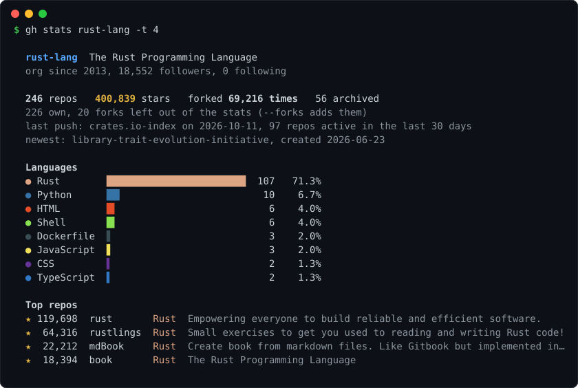

# gh-stats

GitHub stats for any user or org, right in your terminal. Repos, stars, languages, top projects, in one command.

<p align="center">
  
</p>

Language colors are the same ones GitHub uses, so it looks like your profile page.

## Install

As a GitHub CLI extension:

```
gh extension install CanReader/gh-stats
gh stats              # your own stats
gh stats torvalds     # anyone else
```

Or with cargo, which gives you a `gh-stats` binary:

```
cargo install --git https://github.com/CanReader/gh-stats
```

Prebuilt binaries for Linux, macOS and Windows are on the [releases page](https://github.com/CanReader/gh-stats/releases).

## Usage

```
gh-stats                           you (if you're logged in with gh)
gh-stats torvalds                  one user
gh-stats rust-lang                 orgs work too
gh-stats you yourfriend            several at once
gh-stats you -t 10                 show 10 top repos (default 5, 0 hides them)
gh-stats you --forks               count forked repos too
gh-stats you --public              leave out private repos
gh-stats you --md                  Markdown for your profile README
gh-stats you --json                JSON for scripts
```

Forks are skipped by default so the numbers are about your own work. Languages are counted by each repo's main language, the same one GitHub shows on the repo page.

You also get a public/private split, how many repos you pushed to in the last 30 days, and your newest repo.

## Private repos

When you look at yourself, or at an org you're a member of, private repos are counted too and marked `(private)` in the list. For anyone else you only see public ones. `--public` turns this off, and `--md` never includes private repos since it's meant to be posted.

## Put it in your profile README

```
gh-stats you --md
```

prints a short summary with a language table and your top repos with links, public repos only. Paste it into your `username/username` README. It's plain Markdown, so no image service has to be up for it to show.

## Token

It works without a token, but GitHub only gives 60 requests an hour that way. gh-stats looks for a token in this order:

1. `GITHUB_TOKEN`
2. `GH_TOKEN`
3. the GitHub CLI, if you're logged in with `gh auth login`

So if you use `gh` you don't have to set anything. Nothing is ever written, it only reads.

## Colors

Colors turn off when the output isn't a terminal or when `NO_COLOR` is set. Use `--color always` or `--color never` to force it. True color is used when the terminal says it supports it, 256 colors otherwise.

## Notes

- Big accounts are fine, repos are fetched 100 at a time.
- Network hiccups and GitHub 5xx errors are retried a couple of times before giving up.
- If you hit the rate limit it tells you when it resets.
- If one name in a list fails, the rest still print and the exit code is 1.

## License

MIT
